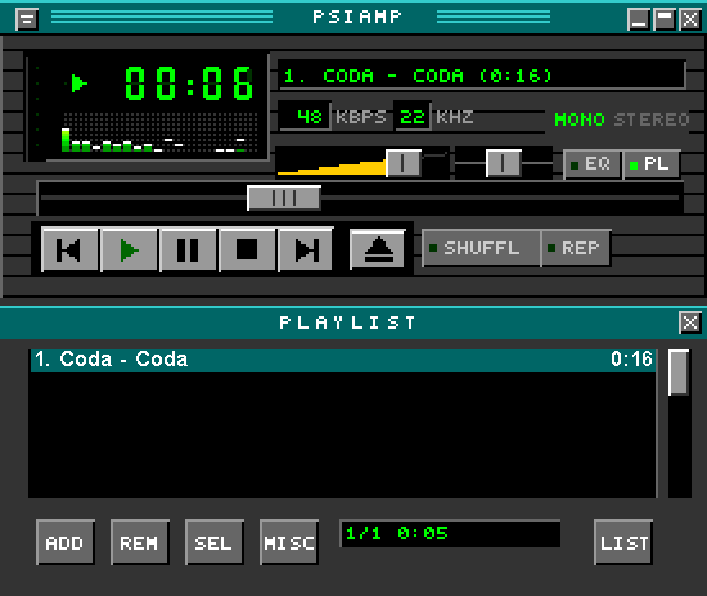
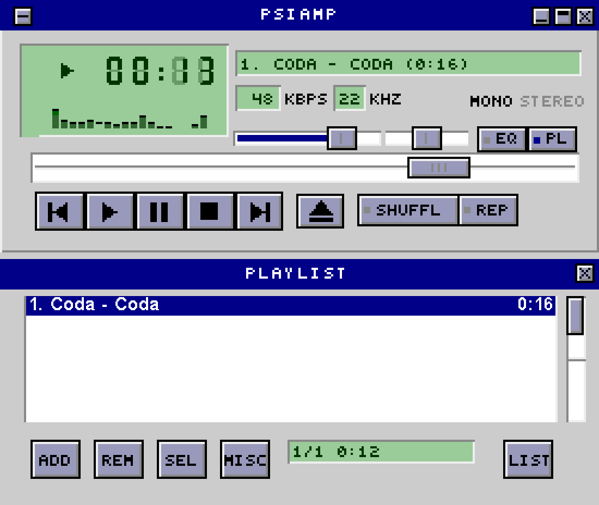
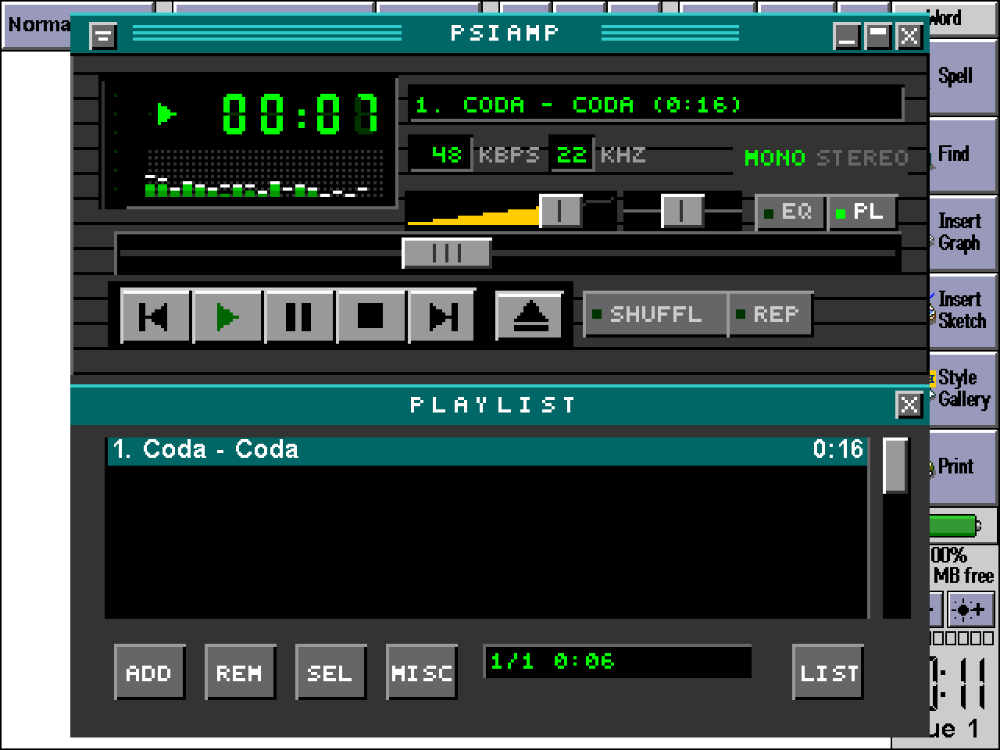
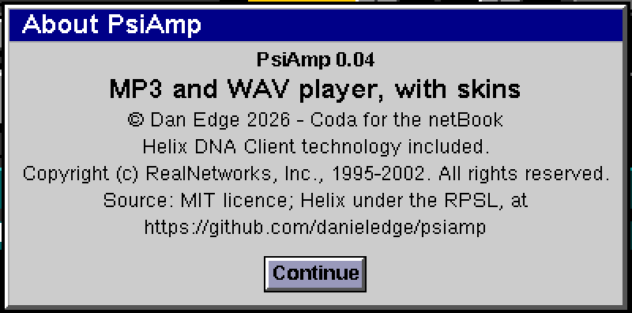

# PsiAmp

[](https://buymeacoffee.com/danedge)

An MP3 and WAV player for the **Psion netBook** (EPOC R5, 640x480, 256 colours), in the look of the classic skinned players of 1999: a small dark player with green LED digits, a scrolling title, a spectrum visualiser, bitrate and rate readouts, bevelled transport buttons, a position bar and a volume slider, and a playlist under it. It floats over the program in use and plays on when it is put away.

PsiAmp is part of [Coda](https://github.com/danieledge/PsiCoda), a new ROM for the netBook, where it is built in; `dist/PsiAmp.sis` installs it on a netBook with the stock ROM too.

- Decodes MP3 with RealNetworks' **Helix** fixed-point decoder (the netBook's StrongARM has no floating point), and plays WAV and M3U playlists.
- Draws **classic Winamp 2 skins** (`.wsz`), its own two (Coda and EPOC) built in.
- Telephone-quality sound: that is all the netBook's sound driver offers (see *What you hear*).

UID 0x01000AFA (the recogniser PsiAmp.mdl: 0x01000AFB). Version 0.06 (not released yet; the download is 0.04).

[](dist/PsiAmp.sis)

## What's new in 0.06

- Started with very little memory free, PsiAmp says "Not enough memory" and closes, where it used to end with "Program closed, KERN-EXEC 3". A start that fails no longer writes an empty playlist over the saved one.

## What's new in 0.05

- The About box has a quiet support line: buymeacoffee.com/danedge.

## What's new in 0.04

- The About box says where the source is (this repository) and under which licences, beside Helix's object code notice.
- `Licences.txt` (MIT and Helix's RPSL) is installed beside the program.
- PsiAmp's source is its own repository (it was part of Coda's).

## Screenshots

Taken in the netBook emulator at 2x. Only PsiAmp's own skins are shown.

<table>
<tr><td><b>Coda, the standard skin</b></td><td><b>EPOC, in the theme's colours</b></td></tr>
<tr>
<td><a href="docs/img/psiamp-coda.png"></a></td>
<td><a href="docs/img/psiamp-epoc.png"></a></td>
</tr>
<tr><td><b>Over Word, playing on</b></td><td><b>About PsiAmp</b></td></tr>
<tr>
<td><a href="docs/img/psiamp-over-word.png"></a></td>
<td><a href="docs/img/psiamp-about.png"></a></td>
</tr>
</table>

## What you hear

EPOC R5 on the netBook plays sound one way only: A-law, 8,000 samples a second, mono, through the sound driver (ESound.ldd, `RDevSound`), which is what Record uses. The driver's own capabilities say so (`TSoundCaps`: maximum frequency 4000, volume 0 to 7 by value). So PsiAmp decodes the MP3 (Helix's fixed-point decoder), mixes it to mono, resamples it to 8,000 a second with a windowed-sinc filter (flat to 3.4 kHz, at least 60 dB down from 4.3 kHz, so no aliasing), and turns it into A-law. That is telephone quality: nothing above about 3.7 kHz, and A-law's 8-bit steps (about 38 dB signal to noise). Speech and simple music come through clearly; cymbals, sibilance and air are gone. Better would need a kernel driver that runs the UCB1200 codec at a higher rate, which the netBook's kernel does not offer.

## Using it

Install `dist/PsiAmp.sis` (to D: if you have a CF card). PsiAmp is on the Extras bar.

| | |
|---|---|
| Open a file | tap an MP3, WAV or M3U on the System screen, or File > Open file (Ctrl+O), or the eject button |
| A folder | File > Open folder (Shift+Ctrl+O; choose any file in it) or Add folder |
| Play, pause, stop | the buttons; Space; Ctrl+P, Shift+Ctrl+P, Ctrl+S; X, C, V |
| Previous, next | the buttons; Shift+Ctrl+B, Shift+Ctrl+N; Ctrl+Left, Ctrl+Right; Z, B |
| Move in the track | drag the position bar; Left and Right (5 s); Go to time (Ctrl+G) |
| Volume | drag the slider; + and -; Up and Down with the playlist hidden |
| The playlist | Up, Down, Enter plays, Del removes; one tap chooses, a second plays; ADD, REM, SEL, MISC, LIST buttons |
| Shuffle, repeat | the buttons; Shift+Ctrl+X, Shift+Ctrl+R; S, R |
| Put away | Esc, or the title bar's minimise or close button (it plays on) |
| From any program | Ctrl+Fn+A shows or puts it away; Ctrl+Fn+X play/pause, Ctrl+Fn+Z previous, Ctrl+Fn+B next (Tools > Preferences turns them off) |
| Double size | View > Double size (Ctrl+M), or the title bar's shade button; standard on the netBook |
| Keep on top | View > Keep on top: the player stays over other programs without taking their keys; a tap brings it forward |
| Skins | K cycles them; View > Skin: Coda (standard), EPOC (in the theme's colours), any `.wsz` in `\System\Apps\PsiAmp\Skins\` or `\Skins\` on C: or D:, or Other skin |
| Speed test | Tools > Speed test: decodes a minute of the file in use as fast as it can and says how much of the processor playing it takes (also in the log) |
| About | Tools > About PsiAmp (Shift+Ctrl+A) |

The time shows elapsed or, tapped (or in Preferences), remaining. A tap on the visualiser changes it: spectrum, oscilloscope, off.

Settings are in `C:\System\Apps\PsiAmp\PsiAmp.ini`, the playlist in `PsiAmp.m3u` beside it, and a log (the sound device's capabilities, the first play requests, speed tests) in `PsiAmp.log`. On the first start the playlist holds the sample, Coda (`\System\Apps\PsiAmp\Coda.mp3`, beside the program).

## Skins

PsiAmp draws a classic Winamp 2 skin: a `.wsz` (a zip) of `main.bmp`, `titlebar.bmp`, `cbuttons.bmp`, `numbers.bmp` (or `nums_ex.bmp`), `text.bmp`, `playpaus.bmp`, `monoster.bmp`, `posbar.bmp`, `volume.bmp`, `balance.bmp`, `shufrep.bmp`, `pledit.bmp`, and `viscolor.txt` and `pledit.txt`, each sprite where those skins put it. What a skin lacks comes from Coda. Pictures are mapped to EPOC's 256 colours. There is no equaliser window, and the balance slider stays in the middle (one speaker).

Coda, the standard skin, is our own drawing (`pkg/mkskin.py`): the case, the LED digits and the letters are made there; there is no logo. EPOC is drawn in key colours that PsiAmp replaces with the theme's as it loads. No other player's bitmaps, logo or names are used, and PsiAmp ships no skins but its own. Put your own skins on the card.

## Files

| | |
|---|---|
| `app/` | the program: `psiamp.cpp` (commands, playlist, keys, settings), `paengine.cpp` (decoder and sound device), `paview.cpp` (the two windows), `paskin.cpp` (skins in 256 colours), `pashim.cpp` (the C library the C code uses, over EUSER) |
| `engine/` | portable C, the same on the netBook and the PC: `pacore.c` (mono, resampling, A-law, the visualiser, WAV and ID3), `paskinc.c` (zip, BMP, the skin's text files), `pakernel.h` (the resampler's filter, from `mkkernel.py`) |
| `helix/` | RealNetworks' Helix fixed-point MP3 decoder (RPSL; see *Credits & licences*), with our changes marked |
| `rec/` | PsiAmp.mdl, the recogniser |
| `pkg/` | `mkskin.py` (Coda and EPOC), `mkicon.py` and `aif8.py` (the icon and .aif in colour), `mksample.py` (the sample) and `Coda.mp3` (what it made), `psiamp.pkg` |
| `test/` | `mkaudio.py` (test sounds, all synthesised), `mkskin2.py` (Amber, a test skin), `host/` (the decoder and sound path on the PC), `emu/` (the netBook emulator) |
| `core/` | [psion-core](https://github.com/danieledge/psion-core), the submodule: zlib, the BX check, the .aif writer, the build image |

## Building

Clone with the core submodule and use the `psion-build` Docker image (see psion-core's [docs/BUILDING.md](https://github.com/danieledge/psion-core/blob/main/docs/BUILDING.md)):

```sh
git clone --recurse-submodules https://github.com/danieledge/psiamp.git
cd psiamp
core/tools/docker/psibuild setup              # once: the image and the SDK
core/tools/docker/psibuild "bash build.sh"    # dist/PsiAmp.sis
```

The C (Helix, `engine/`, zlib's inflate) is built with its own flags (`-march=armv4 -mno-thumb-interwork`: smull and smlal, no BX, which the SA-1100 lacks) into `psiamphx.lib`, which the program's link takes as a library; it must hold no writable data (a program DLL cannot), which build.sh checks. The skins and the icon are drawn by Python at build time. The sample, `pkg/Coda.mp3`, is committed; `python3 pkg/mksample.py pkg/Coda.mp3` makes it again (it needs numpy and ffmpeg with libmp3lame).

`dist/PsiAmp.sis` is committed (build output otherwise goes to `build/` and `dist/`, which are not).

## Testing

- **On the PC** (`test/host`): `make`, then `padec IN NATIVE.wav NETBOOK.wav [LINEAR8K.wav]` runs the decoder and the whole sound path. It matches ffmpeg's decoder to within 2 LSB at 44.1 kHz stereo 128k, 22.05 kHz mono and 48 kHz 192k. `python3 test/mkaudio.py OUT` makes the test sounds.
- **In the netBook emulator** ([psionEmulators](https://github.com/joehaines/psionEmulators), beside this checkout or at `$PSION_EMU`): `test/emu/mkimg.sh OUT` builds PsiAmp and a test image with the test sounds (it uses Coda's image builder, a psion-netbook checkout beside this one, or `$CODA`); `python3 test/emu/emu.py OUT/card.img SHOTS SCRIPT` runs a script of taps and keys and saves screenshots. The emulator's sound driver never completes a request after the first four, so PsiAmp plays on there timed by its own clock, silently.

## Credits & licences

- **PsiAmp's own code** (everything but `helix/` and `core/`): MIT, Copyright (c) 2026 Daniel Edge ([`LICENSE`](LICENSE)).
- **Helix fixed-point MP3 decoder** (`helix/`): Copyright (c) 1995-2004 RealNetworks, Inc., under the RealNetworks Public Source License 1.0 ([`helix/RPSL.txt`](helix/RPSL.txt)) or the RealNetworks Community Source License ([`helix/RCSL.txt`](helix/RCSL.txt)). Taken from [libhelix-mp3](https://github.com/ultraembedded/libhelix-mp3). Our changes are listed in [`helix/PSIAMP-CHANGES.txt`](helix/PSIAMP-CHANGES.txt) and marked in each changed file; they are under the RPSL too. As the RPSL asks, the About box carries its object code notice ("Helix DNA Client technology included. Copyright (c) RealNetworks, Inc., 1995-2002. All rights reserved.") and the address of this source, and `PsiAmp.sis` installs the RPSL's text (`Licences.txt`). PsiAmp as a whole is distributed under the RPSL for the Helix code and MIT, one of the RPSL's compatible licences, for the rest.
- **zlib** (inflate, from psion-core): Jean-loup Gailly and Mark Adler, zlib licence.
- **Coda's skins, icon, sample tune and test sounds** are our own, made in code here.
- **Winamp** is named only to say which skin format PsiAmp reads; no Winamp or Nullsoft artwork is used.
- MP3's patents have expired (2017).

See [NOTICE.md](NOTICE.md) for the details.

## Support

If PsiAmp plays your music on the netBook and you'd like to say thanks, you can [buy me a coffee](https://buymeacoffee.com/danedge).
